<p align="center">
  <picture>
    <source media="(prefers-color-scheme: dark)" srcset="brand/logo-dark.svg">
    
  </picture>
</p>

<p align="center"><strong>Race engineering software for the pit wall.</strong><br>
Strategy, telemetry and alerts for a race team on real Formula 1 timing. Work the live session, rehearse any past race as a mock session with your own clock and a debrief, <strong>take over a real race at any lap (or the live one) and run it yourself</strong>, or drill a full weekend in the simulator, where twenty cars stream hundreds of channels twenty times a second and reach the right engineer within a few milliseconds.</p>

<p align="center">
  <a href="https://github.com/Ivan825/Slipstream/actions/workflows/ci.yml"></a>
  <a href="LICENSE"></a>
  
  
  
  
  
</p>

<p align="center">
  <a href="https://slipstream-flax.vercel.app"><strong>Live demo</strong></a> ·
  <a href="#how-it-works">How it works</a> ·
  <a href="#what-you-get">What you get</a> ·
  <a href="#see-it">See it</a> ·
  <a href="#run-it-locally">Run locally</a> ·
  <a href="#deploy-your-own">Deploy</a> ·
  <a href="docs/ARCHITECTURE.md">Architecture</a> ·
  <a href="docs/STRESS_TEST.md">Stress test</a> ·
  <a href="docs/STRATEGY.md">Strategy engine</a>
</p>

---

<p align="center">
  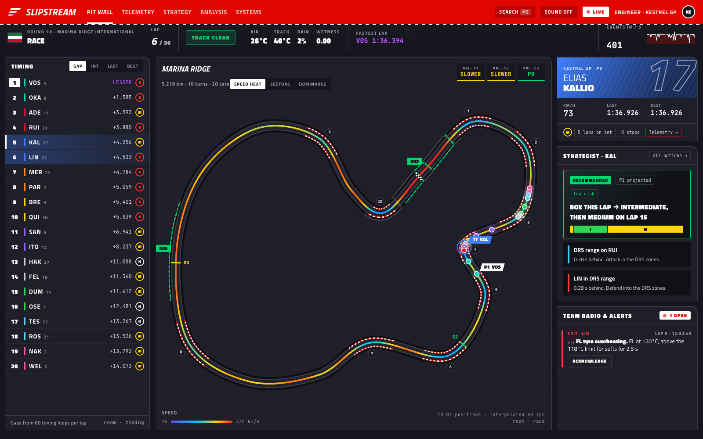
</p>

## The problem

Telemetry systems all hit the same walls once data arrives fast and many people need to watch it:

- **Data arrives faster than a browser can draw it.**
- **People need different slices of it.**
- **Networks duplicate and reorder events.**
- **History and the live stream have to line up**, with no gaps and no double-counting.

A race team is the extreme case. A car sends hundreds of channels at high frequency. Each team's engineers may only see their own cars, while race control sees everything. The decisions that matter most, such as *box now or stay out?* or *slicks or inters?*, are made in seconds from live data combined with history.

Slipstream is a working pit wall for a simulated race weekend (practice, knockout qualifying and the race), built on MongoDB, Express, React, Node.js and Socket.IO.

## How it works

```
 20 cars ── /ingest ──► validate ─► rate-limit ─► dedupe + reorder ─► race state ─► anomalies ─► strategy
 (20 Hz each,           zod        token bucket   per-source seq       timing loops   EWMA, rates   plan search,
  100 ms batches)                                                       sectors, laps  thresholds    weather, rivals
                                        │                                    │
                                        ▼                                    ▼
                                 batch writer ─► MongoDB              broadcaster ─► /live rooms ─► dashboards
                                 (500 ms bulk,   (idempotent)         (per batch, 10 Hz,  (ACL per role
                                  load shedding)                       deltas, backpressure) and team)
```

| Stage | What happens |
|---|---|
| **Ingest** | Each car is its own data source on its own Socket.IO connection. It authenticates with an HMAC API key that binds the connection to exactly one car, so a source can't spoof another car. Every batch is acknowledged with what was accepted, rejected or rate-limited. |
| **Validate and limit** | A strict zod schema checks every frame (ranges, array shapes, no unknown fields, clock skew). A token bucket per source caps the rate. A source that keeps flooding is disconnected. |
| **Dedupe and reorder** | Every frame carries `carId`, a per-source `seq` and a timestamp. Duplicates are dropped. Frames that arrive out of order wait up to 100 ms in a reorder buffer. Frames that arrive too late are stored but never rewind live state. |
| **Race state** | 60 timing loops per lap give real time gaps without scanning history. Sector and lap times are interpolated between frames. Every lap keeps a 25 m trace, its position and its gap to the leader. Pit-lane and stationary times are measured from telemetry. |
| **Store** | Raw frames are written with one unordered `insertMany` every 500 ms. A unique index on `(sessionId, carId, seq)` makes writes idempotent. Raw telemetry expires after a TTL, while laps, traces, pit stops, alerts and results are kept. |
| **Detect** | Detectors for tyre overheating (sustained threshold), punctures (pressure rate of change), brake fade (EWMA z-score per braking event), engine temperature, slow cars and lost telemetry. |
| **Decide** | The strategy engine searches every no-stop, one-stop and two-stop plan, using the same tyre and weather model the cars obey, calibrated online from real lap times. |
| **Broadcast** | A car's frames go out as soon as its batch is applied. Positions go out as compact 10 Hz frames, and timing as changed fields only. Nothing is sent to a room with no subscribers. Slow clients are moved to a 2 Hz feed. |

## Tech stack

| Layer | Technology | Used for |
|---|---|---|
| Database | **MongoDB 7** with Mongoose | Raw telemetry (unique-indexed, TTL hot store); laps with 25 m traces, pit stops, alerts, sessions, users and the command audit log (cold store); aggregation pipelines for analysis |
| Backend | **Node.js 22 + Express 4** | REST API for auth, history, analysis, strategy, race control and HTTP ingest; helmet, CORS, compression, express-rate-limit |
| Real time | **Socket.IO 4** | `/ingest` namespace for data sources (acknowledged batches); `/live` namespace for dashboards (JWT, rooms, volatile emits, backpressure) |
| Frontend | **React 18 + Vite**, React Router, Zustand | Single-page dashboard. High-frequency data lives in mutable ring buffers outside React's render cycle |
| Visualisation | **Canvas 2D**, **uPlot**, Framer Motion | Track map, traces and tyre heatmap on canvas; time-series and analysis charts in uPlot; animated timing tower and transitions |
| Validation and auth | **zod**, **jsonwebtoken**, **bcryptjs** | Strict frame and request schemas; role-based access (race control, engineer, anonymous viewer) |
| Tooling | node:test, GitHub Actions, Docker | Unit and engine tests, CI on every push, single-image deployment |

## Data generation and ingestion

**The simulator** (`simulator/`) generates the data. It models a full race weekend on a fictional 5.218 km circuit built from a closed Catmull–Rom spline.

- A reference speed profile comes from the track's curvature and is calibrated to a 91 s lap.
- Each car follows that profile, scaled by a pace factor from the shared tyre and weather model: compound, tyre age and cliff, track wetness, fuel load, driver skill and track evolution.
- Throttle, brake, gear, RPM, DRS and ERS follow from the car's acceleration.
- Tyre surface temperatures (inner, middle and outer for each corner) respond to cornering load, braking, traction, track temperature and rain. Pressures follow temperature. Brake temperatures spike under braking.
- AI teams pit before their tyres' cliff, switch to intermediates in the rain and take cheap stops under the safety car. In practice and qualifying, cars run programmes from the garage.
- Race control can inject punctures, brake fade, engine or tyre overheating, rain, safety cars and stream-rate bursts.

**Ingestion**

- Every car is an independent source on its own Socket.IO connection to `/ingest`, using an HMAC-derived API key.
- It produces frames at 20 Hz and sends them in 100 ms batches. Each batch is acknowledged.
- The simulator deliberately duplicates about 0.4% of frames and reorders another 0.4%, so the dedupe and reorder logic is always exercised.

**Real data** comes from OpenF1, streamed on demand and cached in MongoDB, live with a subscription key or historical without one. `npm run openf1:import -w server -- --session <session_key> --minutes 0` pre-downloads a whole session.

**Real devices** can push the same frames over plain HTTP: `POST /api/ingest` with an `x-api-key` header. [`examples/http-source.mjs`](examples/http-source.mjs) is a 50-line source that does exactly that.

Every frame identifies its source, sequence number and timestamp:

```json
{ "carId": "KAL", "seq": 18442, "ts": 1763030000123, "lap": 14, "d": 2210.4, "v": 287.4,
  "thr": 1, "brk": 0, "g": 7, "rpm": 11420, "drs": 1, "ers": 62.1, "fuel": 38.4, "tc": "M", "ta": 9, "tw": 31.2,
  "tt": [96.1, 92.4, 89.0, 101.2, 97.3, 93.1, 94.0, 90.2, 87.7, 95.6, 91.8, 88.3],
  "tp": [21.9, 22.1, 21.0, 21.1], "bt": [612, 640, 498, 505], "et": 104.2, "ot": 115.0, "st": "RUN" }
```

## What you get

**Takeover: run a real race yourself.** Fork any real race (a past one at any lap, the one you are watching, or the live race) and the server runs it on from there, calibrated on that session: each driver's pace, tyre degradation and life, pit loss, the circuit's speed profile and the weather. Rivals make the stops their teams really made until the race changes. Your calls change the result: box (now or at a lap) on any compound, engine and tyre modes, team orders, and race control (safety car, VSC, red flag, rain, penalties, punctures, failures, random incidents). The generated data streams through the same rooms and has the same shape as real timing, so every tool on the pit wall works on it, and the debrief sets your race against the real one. [How it works →](docs/TAKEOVER.md)

**A live pit wall.** The circuit is drawn on canvas and coloured by speed, by sector or by **live track dominance**. It shows kerbs, corner numbers, DRS zones, a radar sweep when it rains, and glowing cars with trails, interpolated to 60 fps between 10 Hz updates. Beside the map are a timing tower that slides as positions change, sector colours, tyres and stops, the car card, a weather forecast and a team-radio feed of alerts.

**Car telemetry.** Live speed, throttle, brake, gear and **Delta-T** traces. The car's best lap from MongoDB is drawn as a **ghost** for the live lap to race against. There are shift lights, pedal bars, DRS, ERS, fuel and coolant. A tyre heatmap shows inner, middle and outer temperatures for each corner, alongside pressures and glowing brake discs. The history/live merge seam is shown on screen: frames from the database, from the hot cache and from the live stream, plus duplicates dropped and gaps backfilled.

**A race weekend.**

- **Practice:** cars run programmes from the garage (installation, set-up, quali sims, long runs), each with out, push, cool and in laps. A run monitor computes fuel-corrected long-run pace and degradation live.
- **Qualifying:** a Q1/Q2/Q3 knockout with a red drop-zone line, the cut-off time, the margin to safety, the ideal lap and potential position. Cars that get knocked out stay in the garage.
- **The race:** the grid comes from qualifying.

**A live strategist.** Ranked options with the predicted finishing position, rejoin position and traffic, risk and confidence, recomputed every few seconds. It flags undercut chances and threats, cheap stops under the safety car, rain crossovers, the tyre cliff, fuel margin and DRS battles.

**What-if scenarios.** Ask *what if it rains in four laps?*, *what if there's a safety car next lap?*, *what if the tyres degrade 20% faster?* or *what if my rival pits now?*, then apply a plan with one click. The pit call goes to the car and the audit log. [How it works →](docs/STRATEGY.md)

**Post-session analysis.** Modelled on what race engineers use, built from MongoDB aggregation pipelines:

- classification with grid and positions gained
- best sectors and ideal laps
- race history chart and lap chart
- tyre strategy and pit-stop summary (pit-lane, stationary and net loss)
- lap times by compound and team pace box plots
- consistency (σ)
- **fuel-corrected degradation** fitted per stint inside the database, with compound crossover laps
- a two-driver **telemetry overlay with Delta-T** and a gain/loss map
- **track dominance** by mini-sector
- maximum speeds

[The engineering reference →](docs/RACE_ENGINEERING.md)

**Real Formula 1 timing: live sessions and mock sessions.** Pick your team once (McLaren, Ferrari, …) and every real session is set up around your two cars. Data comes from [OpenF1](https://openf1.org): any session since 2023, with real drivers, teams and colours.

- **Live session:** with an OpenF1 subscription key (`OPENF1_TOKEN`, or `OPENF1_USERNAME` and `OPENF1_PASSWORD`) the pit wall follows the session running right now, a few seconds behind real time, and records it as it runs so it can be rehearsed afterwards.
- **Mock session:** a crew's private copy of a past race on its own clock. It starts paused, at lights out or at any lap you choose. Pause, jump to a lap or run at up to 16×. Share the link and everyone on it works the same clock. Mocks are kept in MongoDB for 60 days, so a crew can pick one up again.
- **Your calls, logged.** On the strategy page each of your cars has a strategist card and a row of call buttons (box for S/M/H/I/W, or stay out). A call is stamped with the mock clock, the car's lap, position and tyres, and what the strategist advised at that moment.
- **Debrief.** After the mock, every call is set against what the real team did: whether they stopped within a lap of your box call, on which tyres, and where the car finished. A strategy timeline draws the tyres each car really ran with your box calls marked on it.
- **Team alerts.** A watcher on the session clock raises what an engineer needs to hear about your cars: the strategist's call changing to a stop, an undercut threat, a rival around you pitting, safety cars, red flags and rain.
- **Archive:** any session can also be opened on a shared clock for everyone looking at it, for a quick review.

**The race engineer's deck.** Under the real pit wall, five tabs work the session for your two cars:

- **Battle forecast:** every car projected lap by lap to the flag (pace now, degradation on the set, fuel burn, a tyre cliff past its life, and the stop it is likely to make). For each of your cars it lists who catches whom and on which lap, whether the swap happens on track or through a stop (an undercut, or losing the place at your own stop), and **where**: the overtaking zone it would most likely happen in (*DRS 1 into T1*), with an on-track pass probability from the pace difference. A gap chart draws the projected gap to each rival over the remaining laps, and the timing tower gets a projected-finish column.
- **Strategies:** every no-stop, one-stop (any lap, any compound) and two-stop plan, plus *box now* (undercut) and *extend five laps* (overcut), simulated to the flag against the field's likely plans and ranked by time with a margin for risk (a set run past its life, a rejoin in traffic). Plan A, B, C… with projected finishing position and a stint bar. When the best plan changes the team watcher calls a **strategy switch**.
- **Driver priority:** which car to look after first (threats, chances, tyre wear, positions a change of plan could win), the pit order and whether a double stack is affordable, team orders (swap when the car behind is clearly quicker, hold otherwise) and splitting strategies when both cars fight the same rival.
- **Tyres:** estimated surface and core temperature and wear for each corner of your cars, coloured against the compound's working window. Public timing has no tyre sensors, so a small thermal model runs on each car's live speed, cornering load (from its yaw rate), braking and traction. Beside it, real data: degradation (lap time against tyre age on the current set, with fitted slopes) and the whole field's tyre history.
- **Team radio:** the drivers' real radio clips from the session. With sound on, your cars' clips play as they come in (or every car's), one at a time.

- **Targets & modes:** the lap time that makes the chosen plan work, with a ±0.15 s band and the last lap's delta to it; how much to manage the tyres so the set reaches the stop (and what that costs); the slowest lap that keeps the car behind out of DRS; the gap needed for a free stop. The mode to ask for (defend or attack in overtake mode, tyre save, harvest in clean air, in-lap and out-lap push, safety-car delta, hold position behind a team-mate) next to the mode the car appears to be running, inferred from its own telemetry: lift-and-coast before braking zones, speed-trap loss against its best, full-throttle share.
- **Flags & incidents:** race control read like an engineer reads it. Penalties (time, drive-through, stop-and-go) and whether they've been served at a stop; outstanding ones count in every projection and strategy. Open investigations involving your cars, track-limits strikes per corner (black-and-white flag, the next one is a penalty), blue flags, yellow sectors, DRS disabled, the stewards' rain risk. Under a safety car or VSC: box now or stay out for each car, with the time it's worth and the double-stack cost; under a red flag: the free tyre change and what to fit for the remaining laps; restarts (standing or rolling).
- **Monte Carlo:** each of the top plans is run 160 times with random safety cars and VSCs (a cheap stop for anyone due within eight laps, the field closed up behind a safety car) and lap-time noise, giving the expected position, the 80% range, podium chances and a histogram. When a plan is safer under uncertainty than Plan A, it says so.
- **Weather:** air and track temperature, humidity, pressure, wind speed and direction (compass), rain, with ten-minute trends, a session chart, a rain risk from the stewards' forecast plus the station (humidity, falling pressure, a track cooling under cloud), and what it means for the tyres.
- **Drivers:** a rating for every driver from this session: pace (best fuel-corrected laps), consistency, tyre management (degradation against the field on the same compound) and racecraft (OpenF1's overtakes made and suffered). Racecraft feeds the pass probabilities.
- **Tyres, properly:** fuel-corrected degradation per set, the whole field's tyre life (age against expected life: fresh, managing, cliff near, past life) and a compound table for the race (degradation, pace against the Medium, longest stint, expected life).
- **Radio:** the engineer's calls to each driver (box, plan, target and delta, mode, gaps and tyre offsets, threats and where to defend, penalties, track limits, blue flags, rain) with a button to say each one, spoken automatically when they change; and every driver radio clip of the session up to the clock, filterable by car.

**Sound.** The nav's sound switch turns on alert tones, the engineer's voice reading out your cars' calls (*"Norris, box, box"*, safety car box or stay out, red flag, penalties, track limits, blue flags, battles, strategy switches, mode changes, two laps off target) and team radio. Browsers only allow audio after a click, so the switch itself unlocks it with a short chirp.

**The circuit, in detail.** The real track map is built from one clean lap of the session: the start/finish line and direction of travel, sectors 1–3, corners (from speed minima, so a chicane may count as one), DRS zones (learnt from every car's DRS as the session plays; the longest straights stand in when cars have no DRS), the speed trap, yellow flags shaded by marshal sector, battles under a second, and a ghost showing where the selected car would rejoin if it boxed now. It can also be coloured by speed or by sector. Lap *X / N* is shown everywhere (for a live race without a known count, estimated from the 305 km rule).

The strategist works from the session's own data, up to the clock: pit loss measured from the stops already made (and what it costs under a VSC or safety car), degradation from lap times on the current set, tyre life from finished stints, where each car would rejoin if it boxed now, undercut threats and chances, the second-dry-compound rule, and a suggested set to fit.

There's one feed path behind all of it. The server streams a session in 2-minute chunks just ahead of the clock. Every chunk is packed into one compressed MongoDB document (about 100 KB for two minutes of all 20 cars), so a session is downloaded once. Stored sessions are capped at a size budget (`REPLAY_CACHE_MB`, default 200 MB) and the least recently used are dropped first; they download again if needed.

Each channel is a Socket.IO room: `replay:<session>` for a shared session, `replay:m-<id>` for a mock. It sends:

- positions interpolated to 5 Hz;
- live timing at 2 Hz;
- race-control messages, laps, pit stops and weather as they happen.

Idle channels close themselves, saving a mock's clock first.

**A demo director.** An optional scripted storyline plays out during the race through the normal race-control path, so a dashboard left open always has something happening: overheating, rain, a puncture, a safety car, brake fade, a VSC.

**Alerts that stay in sync.** Alerts are stored, sent only to the team concerned and to race control, and rate-limited per car. Acknowledging one in one window clears it in every window.

**Race control.**

- Start practice, qualifying or a race; pause or end a session.
- Set the track status: green, yellow, VSC, SC or red.
- Schedule rain.
- Inject punctures, tyre overheating, brake fade or engine overheating. The anomaly engine has to find each one in the data on its own.
- Change the stream rate or fire a 200 Hz burst.

**Numbers, not claims.** A Systems page shows live ingest and broadcast rates, latency percentiles, duplicates, reordered and late frames, DB batch timing, back-pressured clients and event-loop lag. The [stress test](docs/STRESS_TEST.md) records **5,359 events/s from 120 sources with 500 dashboards connected, at a position-frame latency of 11 ms p50 and 23 ms p95**, with nothing shed.

**Roles.**

- **Team pit crew** (one account per real team): works live and mock sessions on real timing, always for its own team's cars. A crew's mock sessions and call logs are private to that team: other crews and guests get a 403 on every REST call and are refused the mock's Socket.IO room. Crew-mates see each other's mocks on the launcher, and each call is signed with the account.
- **Guest** (no account): can run mock sessions too, but a guest mock is open to anyone holding its link.
- **Simulator:** race control sees everything; an engineer sees full telemetry, alerts and strategy for their own simulator team's two cars only, enforced on every REST call and every room join.

## See it

<table>
  <tr>
    <td width="50%">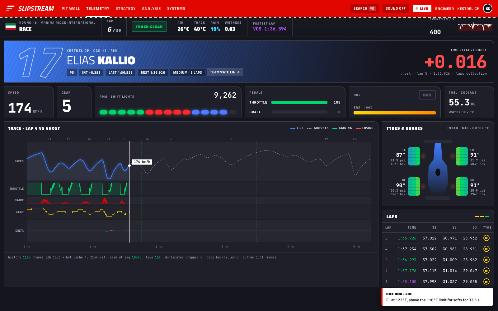<br><sub>Car telemetry: live traces against the ghost lap, shift lights, tyre heatmap, and the history/live merge seam.</sub></td>
    <td width="50%">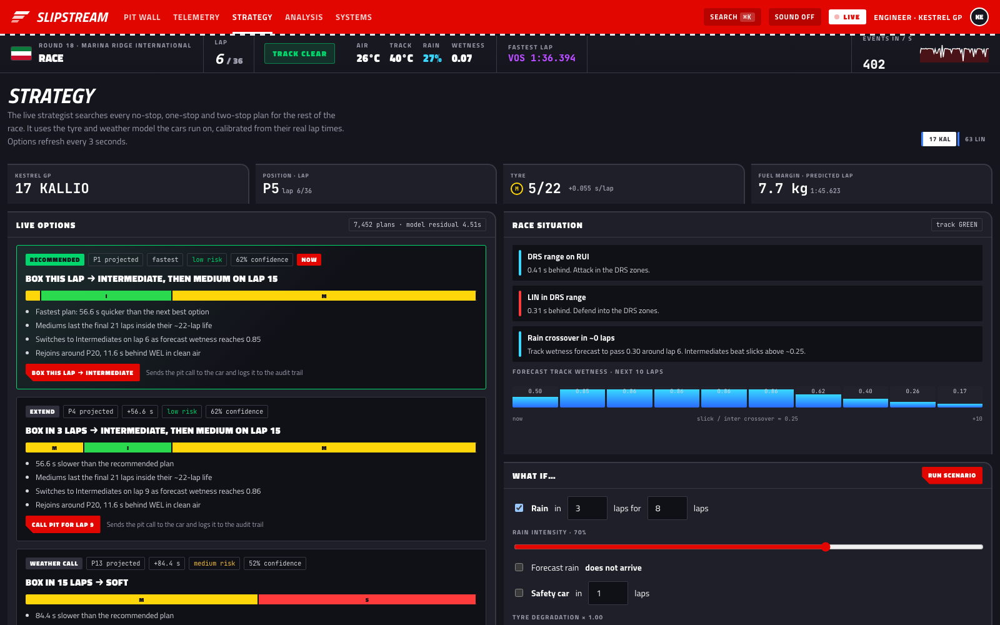<br><sub>The strategist: ranked plans with reasons, insights and the what-if form.</sub></td>
  </tr>
  <tr>
    <td width="50%">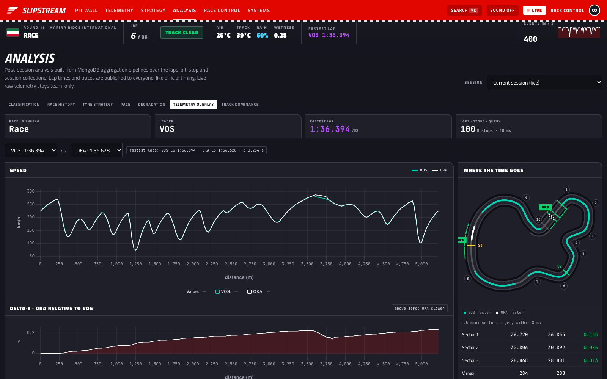<br><sub>Post-session telemetry overlay with Delta-T and where each driver gains.</sub></td>
    <td width="50%">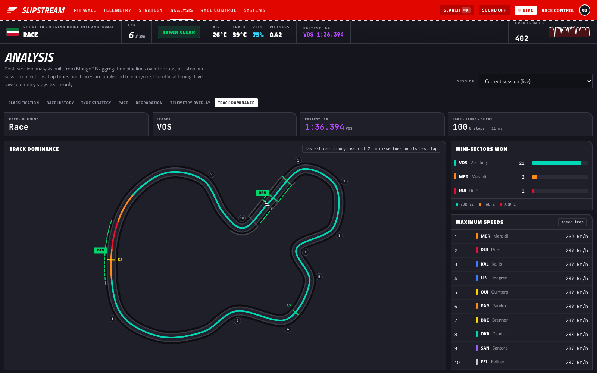<br><sub>Track dominance by mini-sector, plus the speed trap.</sub></td>
  </tr>
  <tr>
    <td width="50%">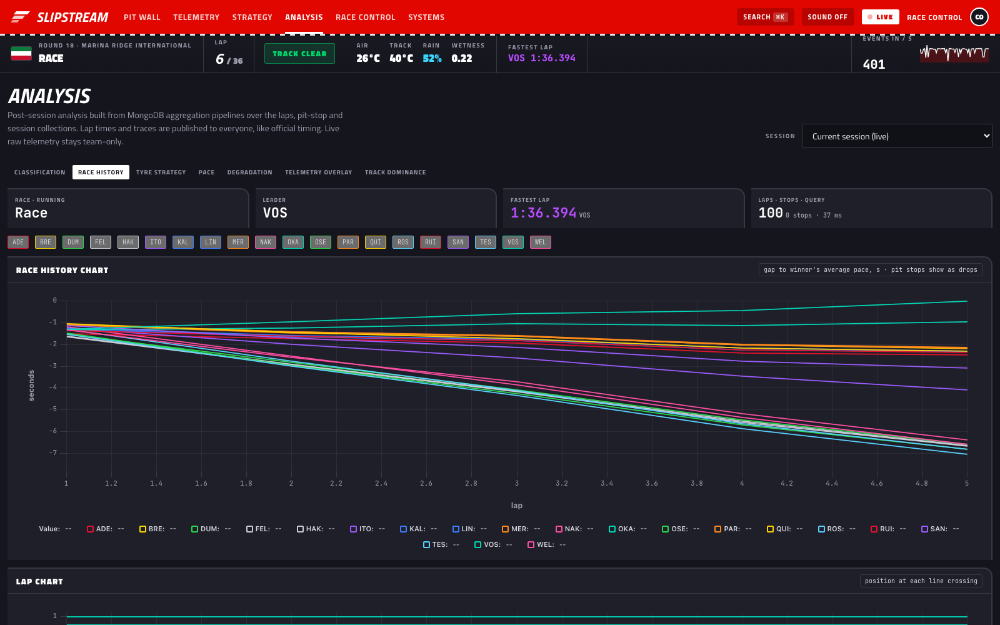<br><sub>Race history chart and lap chart.</sub></td>
    <td width="50%">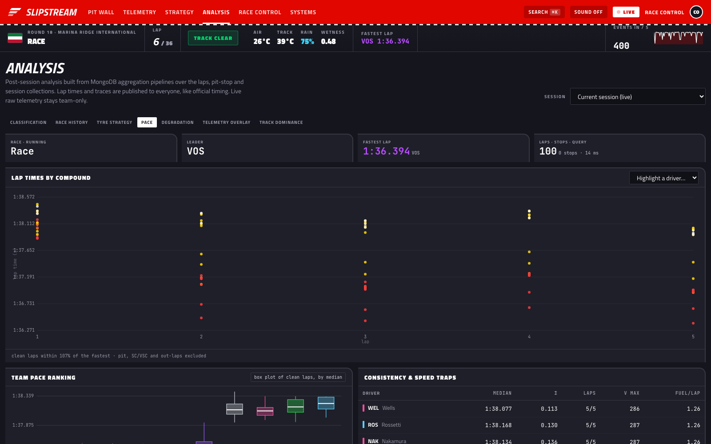<br><sub>Lap times by compound, team pace ranking and consistency.</sub></td>
  </tr>
  <tr>
    <td width="50%">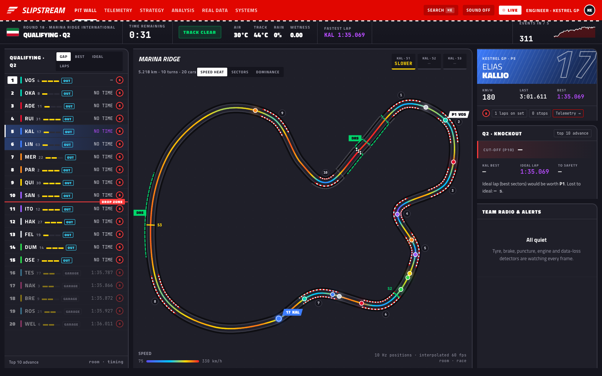<br><sub>Knockout qualifying: drop zone, the Q1 knockouts, cut-off and ideal lap.</sub></td>
    <td width="50%">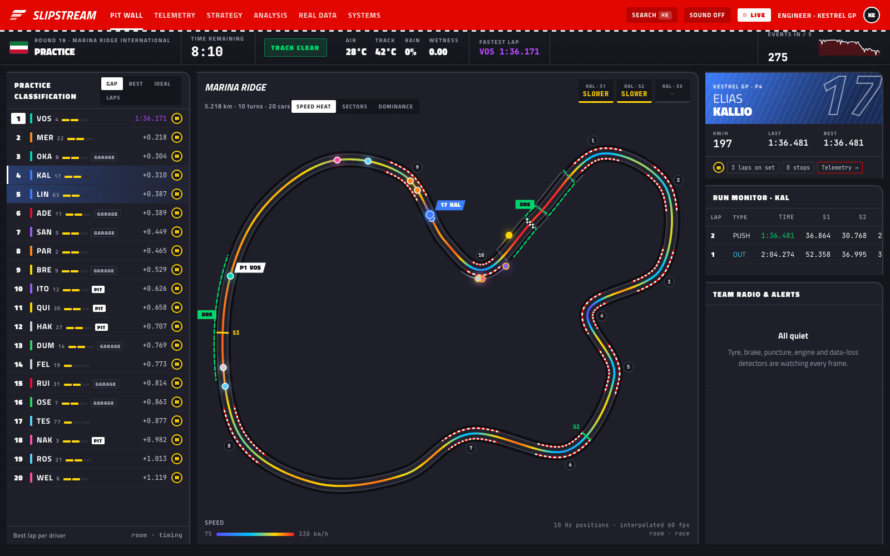<br><sub>Practice: cars run programmes from the garage, and the run monitor tags each lap.</sub></td>
  </tr>
  <tr>
    <td colspan="2">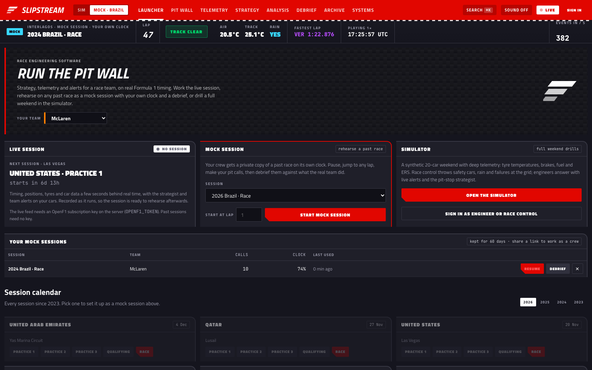<br><sub>The launcher: pick your team, then work the live session, start a mock session of a past race, or open the simulator.</sub></td>
  </tr>
  <tr>
    <td colspan="2">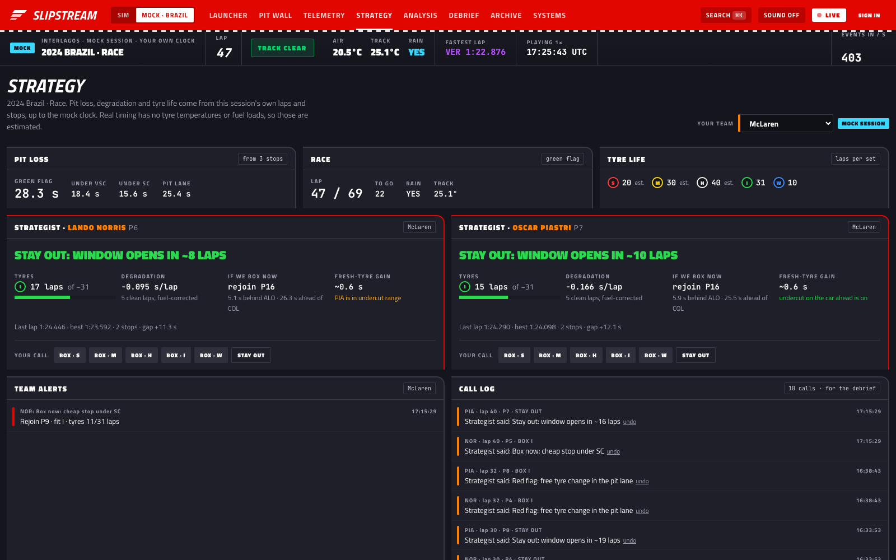<br><sub>A mock session for McLaren: a strategist for each car, the crew's call buttons, team alerts and the call log.</sub></td>
  </tr>
  <tr>
    <td colspan="2">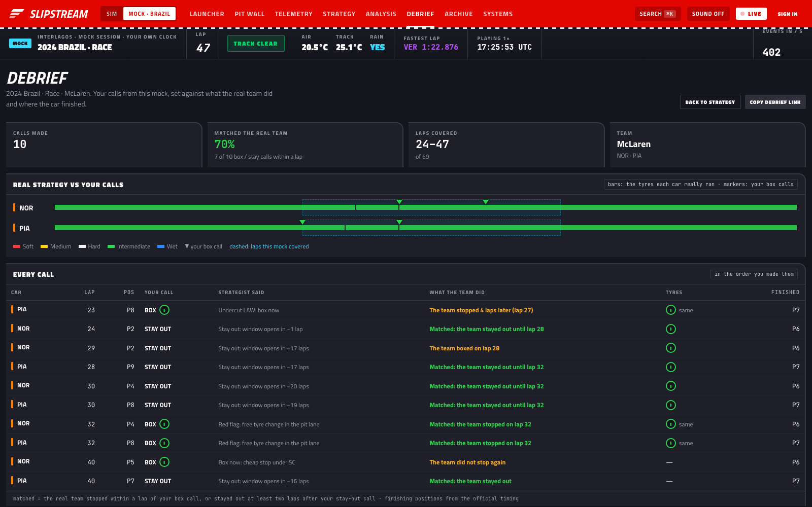<br><sub>The debrief: every call against what the real team did, and the real strategy with your calls marked on it.</sub></td>
  </tr>
  <tr>
    <td colspan="2">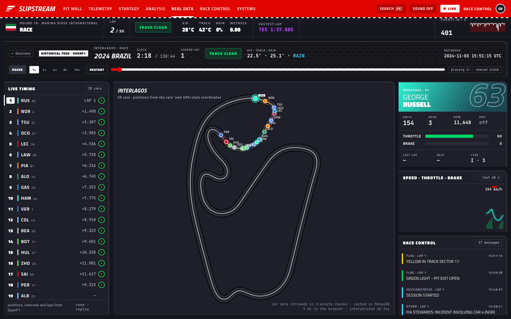<br><sub>Real data: the full wet 2024 Brazilian GP fed through the historical feed on a shared clock, with live timing, every car on the circuit, driver telemetry and race-control messages.</sub></td>
  </tr>
  <tr>
    <td width="50%">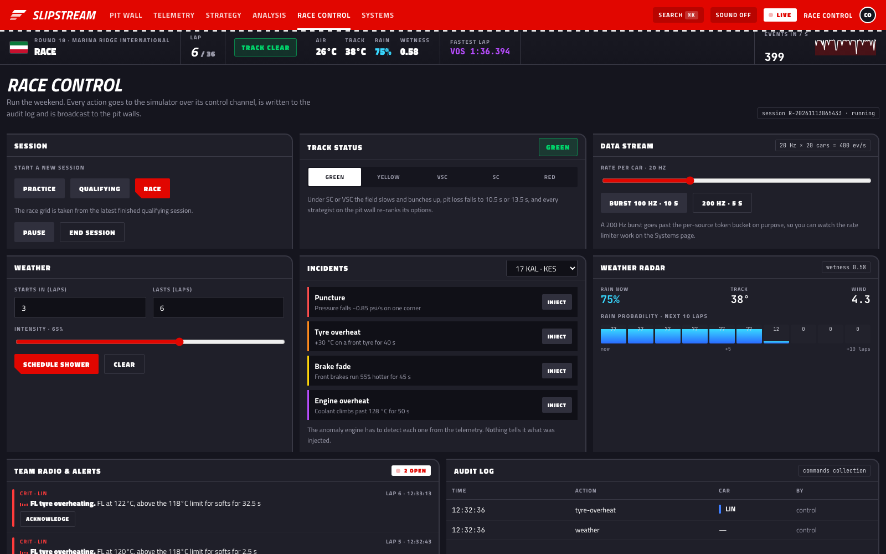<br><sub>Race control: sessions, flags, weather, incidents and the stream rate.</sub></td>
    <td width="50%">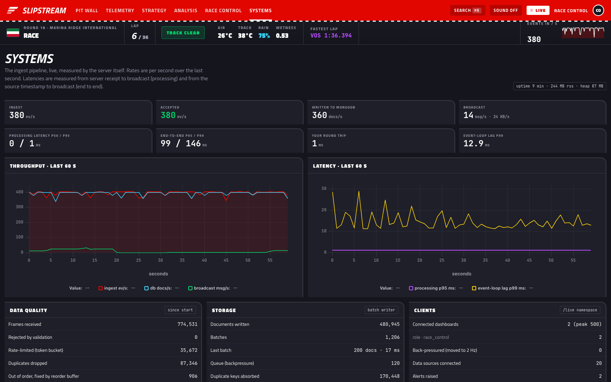<br><sub>Systems: the pipeline measured live by the server itself.</sub></td>
  </tr>
</table>

The screenshots are real. They were captured from a running server on a laptop.

## Try it

**Live:** https://slipstream-flax.vercel.app (dashboard on Vercel, API and sockets on Render). The same app is also served whole from Render at https://slipstream-p92j.onrender.com. Both run on free plans.

Sign in as your team's crew (for example `mclaren` / `slipstream`), or pick a team on the launcher without signing in. Then:

- **Live session:** the Formula 1 session running right now (needs an OpenF1 key on the server; otherwise it shows the next session and a countdown).
- **Takeover:** choose a past race and a lap, then **Take over from lap N** (or **Take over the live race**, or **Take over from here** on any race you're watching). Press play, then use **Takeover · your pit wall** under the map: box, tyres, modes, team orders, and race control. Your calls change the race.
- **Mock session:** choose a past race and a starting lap, then **Start mock session**. Use **Strategy and calls** to make your pit calls, **Share with crew** to send the link, and **Debrief** to see how your calls compare with what the team really did.
- **Simulator:** a 20-car weekend with deep telemetry, alerts and the strategist.

The simulator has its own seats:

- **Simulator engineer:** pick a simulator team, password `slipstream`. Full telemetry, ghost lap, alerts and the strategist for that team's two cars.
- **Race control:** `control` / `slipstream`. Start practice, qualifying or a race; set flags; schedule rain; inject incidents; change the stream rate.

The hosted instance streams 20 cars at 10 Hz to fit the free CPU. Locally they stream at 20 Hz.

## Run it locally

Node 20 or newer (22 recommended) and MongoDB 6+. If you don't have MongoDB, `docker run -d -p 27017:27017 mongo:7` starts one.

```bash
git clone https://github.com/Ivan825/Slipstream.git && cd Slipstream
npm install
cp .env.example .env
npm run dev          # server :4000 + simulator + dashboard on http://localhost:5173
```

Or start everything with one command: `docker compose up --build`, then open http://localhost:4000.

Demo accounts all use the password `slipstream`.

| Role | Username |
|---|---|
| Team pit crew (real timing) | `mclaren`, `ferrari`, `redbull`, `mercedes`, `astonmartin`, `alpine`, `williams`, `racingbulls`, `audi`, `haas`, `cadillac` |
| Race control (simulator) | `control` |
| Simulator engineer | the team id: `kestrel`, `vortex`, `ardent`, `halcyon`, `solaris`, `monarch`, `nordwind`, `verdant`, `azzurra`, `basalt` |
| Guest | no sign-in |

A race starts on its own. **For a demo:**

1. Open two windows, one as `control` and one as `kestrel`.
2. In Race Control, schedule rain in 3 laps. Kestrel's strategist re-ranks its plans around an intermediate crossover.
3. Inject a puncture on car 17. The alert reaches both windows within a tenth of a second, and the strategist switches to *box now*.
4. Acknowledge the alert in one window. It clears in the other.
5. Start a qualifying session to watch the knockout, then a race, which takes its grid from qualifying.

```bash
npm test                                            # sequencer, rate limiter, validation, keys, race timing, anomalies, strategy, weather, track model, takeover race model
npm run loadtest -- --clients 200 --sources 50 --hz 50 --duration 30
```

## Deploy your own

| How | Notes |
|---|---|
| **Docker** | `docker compose up --build` starts MongoDB and Slipstream (API, sockets, simulator and dashboard) on port 4000 |
| **Render + Vercel** | API and sockets on Render ([`render.yaml`](render.yaml)), dashboard on Vercel ([`client/vercel.json`](client/vercel.json)), database on MongoDB Atlas. Step by step in [`docs/DEPLOY.md`](docs/DEPLOY.md) |
| **Any VM or PaaS** | `npm ci && npm run build`, then `SERVE_CLIENT=true EMBED_SIMULATOR=true npm start` |
| **Split** | Dashboard on Vercel ([`client/vercel.json`](client/vercel.json), with `VITE_API_URL` set to the API), server elsewhere |

You need a MongoDB connection string and two long random secrets, `JWT_SECRET` and `INGEST_SECRET`. Every setting, including practice length, qualifying scale, race laps and telemetry TTL, is listed in [`.env.example`](.env.example) and [`server/src/config.js`](server/src/config.js).

## Real-time design

| Namespace / room | Who | Rate | Payload |
|---|---|---|---|
| `/ingest` | each car, plus the simulator controller | 20 Hz in 100 ms batches | frames, acknowledged |
| `race` | engineers, race control | 10 Hz | `[car, lap, distance_dm, km/h, status]` per car, ~400 B for the whole field |
| `race:2hz` | spectators, back-pressured clients | 2 Hz | same |
| `timing` | everyone | 2 Hz | changed fields only, full snapshot every 10 s |
| `car:<ID>` | that car's team, race control | per ingest batch | every 20 Hz frame |
| `team:<id>` | that team, race control | on event | alerts, strategy, pit calls |
| `control` | race control | on event | everything |
| `metrics` | everyone | 1 Hz | pipeline metrics |

**History merged with live data, without duplicates:**

1. The dashboard subscribes to a car first and buffers what arrives.
2. The subscribe acknowledgement returns a **cursor**: the last sequence number already broadcast to that room.
3. The dashboard fetches history up to that cursor. The server answers from MongoDB plus an in-memory hot cache, so frames still in the write batch aren't missed.
4. History and live frames are merged by sequence number, and duplicates are dropped.
5. Any gap that appears later, for example after back-pressure, is backfilled from the API.

Diagrams, the data model and every performance technique are in [`docs/ARCHITECTURE.md`](docs/ARCHITECTURE.md).

## Documentation

| | |
|---|---|
| [`docs/ARCHITECTURE.md`](docs/ARCHITECTURE.md) | System and data-flow diagrams, the socket protocol, the history merge, the MongoDB schema, timing, performance and security |
| [`docs/TAKEOVER.md`](docs/TAKEOVER.md) | Takeover: forking a real race and running it on, the race model and its calibration, storage, the merge with live updates, the API |
| [`docs/STRATEGY.md`](docs/STRATEGY.md) | How the strategy engine models tyres, weather, pit loss and rivals, and the what-if API |
| [`docs/RACE_ENGINEERING.md`](docs/RACE_ENGINEERING.md) | The practice, qualifying, race and analysis views, mapped to what race engineers use, with a glossary |
| [`docs/DEPLOY.md`](docs/DEPLOY.md) | Step-by-step deployment: MongoDB Atlas, Render (API and sockets), Vercel (dashboard) |
| [`docs/STRESS_TEST.md`](docs/STRESS_TEST.md) | Load-test method and results |
| [`.env.example`](.env.example) | Every setting |

## Status

Working end to end on one machine and in Docker:

- the simulator for all three session types;
- the ingest pipeline;
- race timing and the knockout qualifying flow;
- anomaly detection and the strategy engine;
- the analysis API;
- the REST and live namespaces;
- every dashboard page;
- the real-data replay from OpenF1.

**What's tested, and how:**

- `npm test` drives the real car model through the real engines offline: sequencing, rate limiting, validation, keys, lap and sector timing, anomaly detection of injected faults, strategy decisions under rain and the safety car, the weather forecast and the track model. CI runs it on every push.
- The dashboard was checked in headless Chrome with no console errors.
- The stress test was run on an M2 laptop.

**Not built yet:** multi-instance scaling, which would need the Socket.IO Redis adapter and a shared state store.

## Limitations

- **The cars are simulated.** The physics is a believable model, not a vehicle-dynamics package. Lap times, temperatures and degradation are realistic in shape but not calibrated to a real car. Real devices can already stream through `POST /api/ingest`, but only race cars defined in `shared/` take part in timing.
- **One server process.** Rooms and race state live in memory. One process sustains more than 5,000 events/s with 500 dashboards on a laptop. Going further would mean splitting into a single ingest/compute node plus fan-out nodes joined by the Socket.IO Redis adapter. That's designed for but not built.
- **Clocks.** Source-to-dashboard latency uses the source timestamp, so it's exact only when the sources and the server share a clock, which they do in the bundled setup. Round-trip latency on the Systems page and the session countdown are corrected for clock offset.
- **The strategist is a model.** It's deterministic and explainable, and only as good as the tyre and weather model it shares with the simulator.
- **Real-session projections are estimates.** Public timing has no fuel loads, tyre temperatures or the teams' own models: degradation and tyre life are fitted from the session's lap times and finished stints, and tyre temperatures come from a thermal model. Corner numbers are detected, so they can differ from the official ones.

## Credits

Built with [Express](https://expressjs.com/), [Socket.IO](https://socket.io/), [Mongoose](https://mongoosejs.com/), [zod](https://zod.dev/), [jsonwebtoken](https://github.com/auth0/node-jsonwebtoken), [bcryptjs](https://github.com/dcodeIO/bcrypt.js), [helmet](https://helmetjs.github.io/), [express-rate-limit](https://github.com/express-rate-limit/express-rate-limit), [cors](https://github.com/expressjs/cors), [compression](https://github.com/expressjs/compression), [React](https://react.dev/), [React Router](https://reactrouter.com/), [Vite](https://vitejs.dev/), [Zustand](https://github.com/pmndrs/zustand), [Framer Motion](https://www.framer.com/motion/) and [uPlot](https://github.com/leeoniya/uPlot), all MIT licensed. Real session data comes from [OpenF1](https://openf1.org), an unofficial open API (free historical data, for non-commercial use). Team-radio clips are Formula 1's own recordings, linked (not copied) from the URLs OpenF1 publishes. Engineer voice calls use the browser's built-in speech synthesis. Slipstream isn't associated with Formula 1 companies, and F1, FORMULA 1 and related marks belong to their owners. Fonts are [Titillium Web](https://fonts.google.com/specimen/Titillium+Web) and [JetBrains Mono](https://fonts.google.com/specimen/JetBrains+Mono) (SIL Open Font License).

The circuit is a Catmull–Rom spline. Anomaly baselines use exponentially weighted moving averages. Rate limiting is a token bucket. The analysis views follow the conventions of professional motorsport data systems and official timing documents, as described in [`docs/RACE_ENGINEERING.md`](docs/RACE_ENGINEERING.md). In the simulated weekend, team, driver and circuit names are fictional. The F1 session views show real, recorded session data from OpenF1.

## Licence

[MIT](LICENSE).
