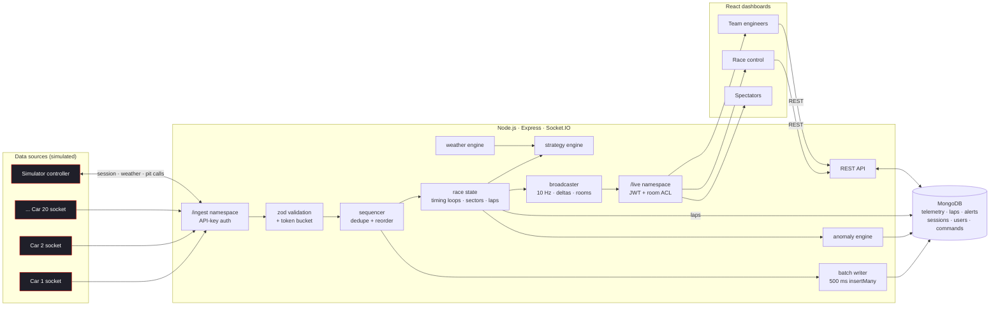

<div align="center">

# SLIPSTREAM

### Real-time race telemetry for the pit wall

A real-time telemetry platform built on **MongoDB, Express, React, Node.js and Socket.IO**.
It streams a simulated 20-car grand prix at **20 Hz per car**: every car's speed, throttle, brake, gear, RPM, tyre temperatures (inner, middle and outer for each corner), tyre pressures, brake temperatures, fuel and ERS.
The data is processed, stored and broadcast live to many dashboards at once, each subscribed only to the data its user is allowed to see.

`MongoDB` · `Express` · `React` · `Node.js` · `Socket.IO` · `Canvas` · `uPlot` · `Framer Motion`

</div>

---

## Contents

1. [The problem](#the-problem)
2. [What Slipstream does](#what-slipstream-does)
3. [Features](#features)
4. [Tech stack](#tech-stack)
5. [Architecture](#architecture)
6. [Data generation and ingestion](#data-generation-and-ingestion)
7. [Real-time communication](#real-time-communication)
8. [History and live without duplicates](#history-and-live-without-duplicates)
9. [Live strategy engine](#live-strategy-engine)
10. [Anomaly detection and alerts](#anomaly-detection-and-alerts)
11. [Performance optimisations](#performance-optimisations)
12. [Getting started](#getting-started)
13. [Running and testing](#running-and-testing)
14. [Stress testing](#stress-testing)
15. [Deployment](#deployment)
16. [Project structure](#project-structure)
17. [Credits and attribution](#credits-and-attribution)

---

## The problem

Infrastructure, vehicle fleets and IoT deployments produce continuous, high-frequency telemetry. Monitoring it live is hard:

- Data arrives faster than a browser can render it.
- Many people need to watch it at once, and each of them needs a different slice.
- Duplicate and out-of-order events corrupt the picture.
- History and live data have to line up without gaps or double-counting.

Motorsport is an extreme version of this problem. A race car streams hundreds of channels at high frequency. Each team's engineers may only see their own cars. Race control sees everything. Decisions such as when to pit or which tyre to fit have to be made in seconds, from live data combined with history.

## What Slipstream does

Slipstream is a **live pit wall**. Twenty simulated cars race on a fictional 5.218 km circuit. Each car is an independent data source on its own Socket.IO connection.

The server works through each frame in order:

1. Validates it and applies a rate limit.
2. Removes duplicates and puts frames back in order.
3. Computes the live race state: positions, gaps, sector and lap times.
4. Detects anomalies.
5. Runs a strategy engine.
6. Stores the history in MongoDB.
7. Broadcasts compact updates to Socket.IO rooms.

Dashboards subscribe only to what their user is allowed to see:

| Role | What they see |
|---|---|
| **Race control** | Every car, every alert, plus session, weather and incident controls |
| **Team engineer** | Full telemetry, alerts and live strategy for **their own team's two cars only** |
| **Spectator** | Public positions and timing at a reduced rate, no sensitive telemetry |

## Features

### Live monitoring
- **Pit wall dashboard.** A canvas track map coloured by speed, with glowing cars and trails, DRS zones, kerbs and corner numbers. Next to it are an animated timing tower, the selected car's card, and a team-radio-style alert feed.
- **Car telemetry view.** Live speed, throttle, brake, gear and delta traces. Shift lights driven by RPM. Pedal, DRS, ERS and fuel gauges. A tyre heatmap with inner, middle and outer surface temperatures for each corner, plus glowing brake discs.
- **Ghost lap.** The car's best lap, loaded from MongoDB, is overlaid on the lap being driven live, with a live time delta.
- **Weather.** Rain intensity, track wetness and a lap-by-lap rain forecast.

### Intelligence
- **Live strategy engine.** Ranked race-strategy options, recomputed every few seconds from live telemetry, the weather forecast and what competitors are doing. It covers pit windows, compound choice, undercut and overcut chances and threats, cheap stops under a safety car, and rain crossovers.
- **What-if scenarios.** Ask the strategist "what if it rains in 4 laps?", "what if there's a safety car next lap?", "what if tyres degrade 20% faster?" or "what if my rival pits now?".
- **One-click pit calls.** An engineer can apply a recommendation, and the car pits.
- **Anomaly detection.** Threshold, rate-of-change and statistical (EWMA z-score) detectors raise alerts for tyre overheating, punctures, brake fade, engine temperature, slow cars and lost telemetry. Acknowledging an alert syncs to every connected client.

### Engineering
- Socket.IO **namespaces** (`/ingest` for data sources, `/live` for dashboards) and **rooms**: race, timing, each car, each team, control and metrics.
- **Selective broadcasting:** rooms with no subscribers get nothing.
- **Delta-only timing updates** and **compact array payloads**.
- **Batching:** 100 ms at the source, 10 Hz broadcast ticks, and 500 ms bulk writes to MongoDB.
- **Dedupe and reorder buffer.** Every event carries a source ID, a sequence number and a timestamp.
- **Idempotent storage** through a unique index on `(sessionId, carId, seq)`.
- **Validation and rate limiting:** zod schemas, a token bucket per source, payload size limits, and REST rate limits.
- **Backpressure.** Slow clients are moved to a 2 Hz feed, and the database queue sheds load under overload. Nothing blocks the live path.
- **JWT auth with role-based access control** on both REST and every Socket.IO room join.
- A **Systems page** with live ingest rate, broadcast throughput, p95 latency, duplicates, out-of-order counts, DB batch latency and event-loop lag.
- A **load-testing tool** that drives many sources and many headless clients and reports latency percentiles.

### Visual design
The design takes cues from modern motorsport broadcast graphics: carbon-navy surfaces, racing-red accents, heavy uppercase type, team-colour liveries, outlined driver numbers, and purple, green and yellow sector colours. Details include:

- a start-lights sequence when a session goes live
- FLIP-animated timing-tower reshuffles
- chequered-flag page transitions
- a ⌘K command palette
- optional team-radio sounds

All names, teams, drivers and the circuit are fictional.

## Tech stack

| Layer | Technology | Why |
|---|---|---|
| Database | **MongoDB** (Mongoose) | Unique-indexed raw telemetry with a TTL (hot store), and laps with downsampled traces (cold store). Aggregation pipelines for analysis. |
| Backend | **Node.js + Express** | REST API for history, analysis, auth, strategy and race control. |
| Real time | **Socket.IO** | Namespaces, rooms, acknowledgements and volatile emits for the live data path. |
| Frontend | **React + Vite** | SPA with React Router. Zustand stores updated outside React's render cycle. |
| Charts | **Canvas 2D** and **uPlot** | High-frequency rendering without per-point DOM nodes. |
| Motion | **Framer Motion** | Layout animations for the timing tower and page transitions. |
| Validation | **zod** | Strict schemas for every incoming frame. |
| Auth | **JWT + bcrypt** | Roles: race control, engineer and viewer. |

## Architecture



More detail, including the data-flow diagram, database schema and sequence diagrams, is in [`docs/ARCHITECTURE.md`](docs/ARCHITECTURE.md).

## Data generation and ingestion

**The simulator** (`simulator/`) models a race on a circuit built from a smooth closed spline:

- A **reference speed profile** is derived from the track's curvature, and calibrated so a reference lap takes 91 s.
- Each car follows that profile, scaled by a **pace factor** from a tyre and weather model: compound, tyre age and degradation cliff, track wetness, fuel load and driver skill.
- Throttle, brake, gear, RPM, DRS and ERS come from the car's acceleration.
- **Tyre temperatures** react to cornering load (outer tyres heat up), braking, traction, track temperature and rain.
- **Pressures** follow temperature. **Brake temperatures** spike under braking and cool on straights.
- AI teams make **pit stops** before their tyre cliff, switch to intermediates when it rains, and take cheap stops under a safety car.
- **Race control can inject incidents:** punctures, brake fade, engine overheating, tyre overheating, rain showers, safety cars, and stream-rate changes or bursts.

**Ingestion:**

- Every car opens its own Socket.IO connection to `/ingest` with an HMAC-derived API key. The key binds the connection to exactly one `carId`, so a source can't spoof another car.
- Frames are produced at 20 Hz and sent in **100 ms batches**, with a Socket.IO **acknowledgement** that reports accepted, rejected and limited counts.
- To prove the pipeline is robust, the simulator deliberately **duplicates** about 0.4% of frames and delivers about 0.4% **out of order**.

Each frame carries `carId` (source), `seq` (per-source monotonic sequence) and `ts` (source timestamp), followed by the channels:

```json
{ "carId": "KAL", "seq": 18442, "ts": 1763030000123, "lap": 14, "d": 2210.4, "v": 287.4,
  "thr": 1, "brk": 0, "g": 7, "rpm": 11420, "drs": 1, "ers": 62.1, "fuel": 38.4,
  "tc": "M", "ta": 9, "tw": 31.2, "tt": [96.1, 92.4, 89.0, 101.2, 97.3, 93.1, 94.0, 90.2, 87.7, 95.6, 91.8, 88.3],
  "tp": [21.9, 22.1, 21.0, 21.1], "bt": [612, 640, 498, 505], "et": 104.2, "ot": 115.0, "st": "RUN" }
```

## Real-time communication

| Namespace / room | Who | Rate | Payload |
|---|---|---|---|
| `/ingest` | cars + simulator controller | 20 Hz in 100 ms batches | frames (ack'd) |
| `race` | engineers, race control | 10 Hz | `[carIndex, lap, distance_dm, speed, status]` per car |
| `race:2hz` | spectators and back-pressured clients | 2 Hz | same |
| `timing` | everyone | 2 Hz | **changed fields only**, full snapshot every 10 s |
| `car:<ID>` | that car's team + race control | 10 Hz | every 20 Hz frame since the last tick (no loss) |
| `team:<id>` | that team + race control | on event | alerts, laps, strategy, pit-call audit |
| `control` | race control | on event | all alerts and commands |
| `metrics` | Systems page | 1 Hz | pipeline metrics |

- Clients send `subscribe` and get back an acknowledgement listing the rooms joined, the rooms denied and a snapshot.
- The server checks every room join against the user's JWT role and team.
- Rooms with no members are never serialised.

## History and live without duplicates

On the car telemetry page:

1. The client **subscribes first** to `car:<ID>` and starts buffering live frames.
2. The subscribe ack returns a **cursor**: the last sequence number already broadcast to that room. Every live frame after it is guaranteed to have `seq > cursor`.
3. The client fetches history with `GET /api/telemetry/:carId?toSeq=<cursor>`. The server merges MongoDB with an in-memory **hot cache** of recent frames, so frames still waiting in the write batch aren't missed.
4. The client merges history and the buffered live frames **by `seq`**, drops any duplicates, and shows the merge seam.
5. If a later live frame skips sequence numbers (for example after back-pressure), the client **backfills the gap** from the API.

The ghost lap works the same way. The best lap's 25 m trace is read from the `laps` collection, and the live lap's time-at-distance is built from the merged stream.

## Live strategy engine

The strategy engine (`server/src/core/strategy.js`) recomputes options for every car with an active subscriber every 3 seconds. It:

- predicts lap times with the **same tyre and weather model the cars use**, calibrated online from each car's actual lap times;
- enumerates no-stop, one-stop and two-stop plans across every compound and stop lap, and enforces the two-dry-compound rule;
- integrates the **weather forecast** lap by lap into predicted track wetness, so it can recommend slick-to-intermediate crossovers before the rain arrives;
- prices pit stops at **21 s under green, 13.5 s under VSC and 10.5 s under a safety car**;
- projects every competitor's race to predict **finishing position** and the **rejoin position and traffic** after a stop;
- flags **undercut opportunities and threats**, the tyre cliff, fuel margin and DRS battles;
- supports **what-if scenarios** (rain, safety car, faster degradation, rival stops) through `POST /api/strategy/:carId/whatif`;
- lets engineers **apply** an option. The pit call is sent to the car, logged to an audit trail, and broadcast to the team.

## Anomaly detection and alerts

| Detector | Method | Severity |
|---|---|---|
| Tyre overheating | corner average above the compound limit for 2.5 s (sustained threshold) | critical |
| Puncture | tyre pressure falling faster than 0.4 psi/s (rate of change) | critical |
| Brake fade | peak brake temperature per braking event compared with an EWMA baseline (z-score > 3.5) | warning |
| Engine temperature | coolant above 120 °C (warning) or 128 °C (critical) for 3 s | warning / critical |
| Slow car | below 45% of the reference speed for 3 s under green | warning |
| Telemetry lost | no frames from a source for 2 s during a session (heartbeat) | warning |

Alerts are stored in MongoDB, broadcast to the team and race-control rooms, and rate-limited per car and type. Acknowledging an alert updates the database and syncs to every client.

## Performance optimisations

- **Server:**
  - O(1) token buckets.
  - A bounded dedupe window.
  - Timing loops (60 per lap) for real gap timing without scanning history.
  - One `insertMany` per 500 ms with `ordered: false`.
  - A bounded write queue with load shedding.
  - Event-loop delay monitoring.
- **Wire:**
  - Positions sent as integer arrays, about 15 bytes per car.
  - Distance is sent instead of x/y; the client rebuilds positions from the shared track model.
  - Timing updates carry only the fields that changed.
  - Volatile emits for positional frames.
  - Rooms with no subscribers are skipped.
- **Client:**
  - Socket handlers write into ring buffers and mutable stores, not React state.
  - Canvas layers redraw in a single `requestAnimationFrame` loop, with car positions interpolated between 10 Hz frames for 60 fps motion.
  - React re-renders are throttled to about 4 Hz for tables.
  - Time windows are kept bounded.
  - Static track geometry is rendered once to an offscreen canvas.

## Getting started

**Prerequisites:** Node.js 20 or newer (22 recommended), and MongoDB 6+ running locally, via Docker or on Atlas.

```bash
# 1. clone and install
git clone https://github.com/Ivan825/Slipstream.git
cd Slipstream
npm install

# 2. MongoDB (skip if you already have one)
docker run -d --name slipstream-mongo -p 27017:27017 mongo:7

# 3. environment
cp .env.example .env

# 4. run everything: server (4000) + simulator + client (5173)
npm run dev
```

Open **http://localhost:5173** and sign in with a demo account:

| Role | Username | Password |
|---|---|---|
| Race control | `control` | `slipstream` |
| Team engineer (Kestrel GP) | `kestrel` | `slipstream` |
| Team engineer (any team) | team id, e.g. `vortex`, `ardent`, `halcyon` | `slipstream` |
| Spectator | *no login needed* | |

**Single-process mode:** `npm run build`, then set `SERVE_CLIENT=true` and `EMBED_SIMULATOR=true` and run `npm start`. This serves everything from one Node process on port 4000.

## Running and testing

```bash
npm test                # unit tests: sequencer, token bucket, validation, anomaly, strategy, track model
npm run loadtest -- --clients 200 --duration 60      # many dashboards
npm run loadtest -- --sources 50 --hz 100 --duration 30   # many/fast sources
```

**Demo walkthrough:**

1. Open two browser windows: one as `control`, one as `kestrel`.
2. In Race Control, inject rain in 3 laps. The Kestrel strategy panel immediately re-ranks its options around an intermediate-tyre crossover.
3. Inject a puncture on car 17. A critical alert appears in both windows within about 100 ms, and the strategist switches to "Box now".
4. Acknowledge the alert in one window. It clears in the other.
5. Open the Systems page to watch ingest rate, latency and duplicate/out-of-order counters live.

## Stress testing

`loadtest/` spins up N extra data sources and K headless dashboard clients. It measures end-to-end latency (source timestamp to client receive) and reads the server's own metrics.

> Results table is generated by `npm run loadtest` and recorded in [`docs/STRESS_TEST.md`](docs/STRESS_TEST.md).

## Deployment

- **One service on Render.** `render.yaml` defines a web service that builds the client and serves it from Express, with the simulator embedded. Set `MONGO_URI` to a MongoDB Atlas connection string.
- **Split hosting.** Deploy the client to Vercel (`client/vercel.json`, `VITE_API_URL` pointing at the API) and the server to Render or Railway.
- **Docker:** `docker compose up --build` starts MongoDB, the server, the simulator and the client.

## Project structure

```
slipstream/
├── shared/       track geometry, teams, tyre/weather model, wire protocol (used by all packages)
├── simulator/    race physics model + one Socket.IO data source per car
├── server/       Express REST API, Socket.IO namespaces, ingest pipeline, engines, MongoDB models
│   └── src/
│       ├── ingest/   validation, token bucket, sequencer (dedupe + reorder)
│       ├── core/     race state, anomaly, strategy, weather, batch writer, metrics
│       ├── live/     /live namespace, room ACL, broadcaster, backpressure
│       ├── routes/   REST endpoints
│       └── models/   Mongoose schemas
├── client/       React dashboard (pit wall, telemetry, strategy, replay, race control, systems)
├── loadtest/     stress-testing tool
└── docs/         architecture, data model, stress-test results
```

## Credits and attribution

**Open-source libraries:**

- [Express](https://expressjs.com/), [Socket.IO](https://socket.io/), [Mongoose](https://mongoosejs.com/), [zod](https://zod.dev/), [jsonwebtoken](https://github.com/auth0/node-jsonwebtoken), [bcryptjs](https://github.com/dcodeIO/bcrypt.js), [helmet](https://helmetjs.github.io/), [express-rate-limit](https://github.com/express-rate-limit/express-rate-limit), [cors](https://github.com/expressjs/cors) and [compression](https://github.com/expressjs/compression). All MIT licensed.
- [React](https://react.dev/), [React Router](https://reactrouter.com/), [Vite](https://vitejs.dev/), [Zustand](https://github.com/pmndrs/zustand), [Framer Motion](https://www.framer.com/motion/) and [uPlot](https://github.com/leeoniya/uPlot). All MIT licensed.
- Fonts: [Titillium Web](https://fonts.google.com/specimen/Titillium+Web) and [JetBrains Mono](https://fonts.google.com/specimen/JetBrains+Mono), via Google Fonts under the SIL Open Font License.

**Algorithms:**

- Catmull–Rom splines for the circuit geometry.
- Exponentially weighted moving averages for anomaly baselines.
- Token-bucket rate limiting.

**Data:** all telemetry is simulated. Team, driver and circuit names are fictional and not affiliated with any real racing series.

## License

MIT
