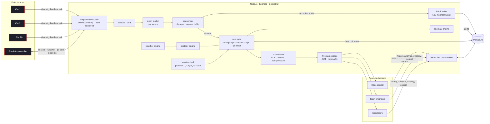
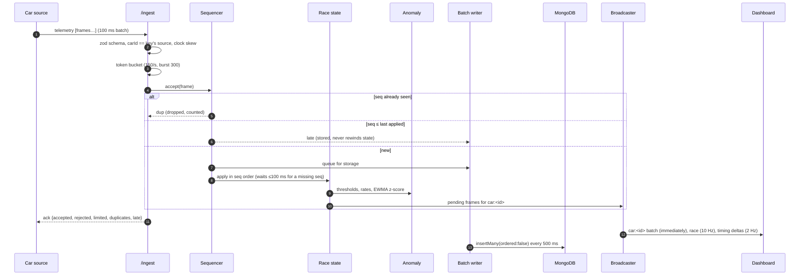
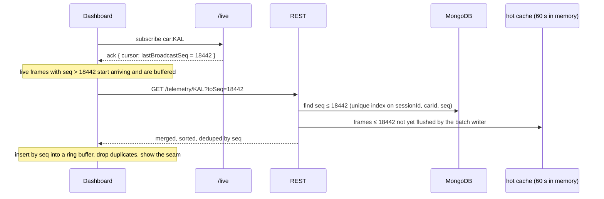
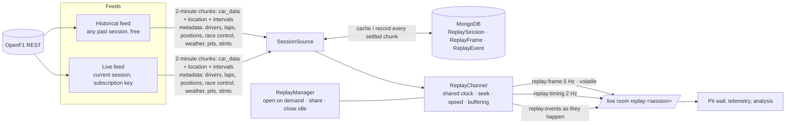
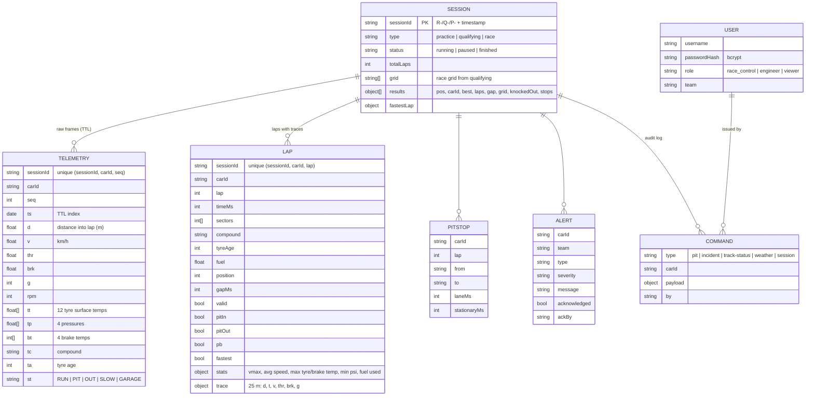

# Architecture

Slipstream is one Node.js server, one MongoDB database and any number of browsers. The data sources (simulated cars) connect to the server over Socket.IO exactly like real ones would. In development and on single-service hosting, the simulator runs inside the server process but still talks to it through the `/ingest` namespace.

## System

## Data flow of one telemetry frame

## Real-time protocol

Two Socket.IO namespaces keep data sources and dashboards apart: they have different authentication, different payload limits and different event sets.

| Namespace | Auth | Events in | Events out |
|---|---|---|---|
| `/ingest` | `apiKey = <sourceId>.<HMAC(secret, sourceId)>` | `telemetry` (≤ 50 frames, acknowledged) | `sim:state`, `sim:command` to the controller |
| `/live` | optional JWT (no token = public viewer) | `subscribe`, `unsubscribe`, `alert:ack` | `race`, `timing`, `car`, `lap`, `alert`, `alert:acked`, `strategy`, `command`, `pitstop`, `session`, `metrics` |

Rooms on `/live`, and who may join them:

| Room | Race control | Engineer | Spectator | Rate |
|---|---|---|---|---|
| `race` | ✓ | ✓ | redirected to `race:2hz` | 10 Hz |
| `race:2hz` | | | ✓ | 2 Hz |
| `timing` | ✓ | ✓ | ✓ | 2 Hz, changed fields only |
| `car:<ID>` | ✓ | own team only | ✗ | every frame, per ingest batch |
| `team:<id>` | ✓ (via `control`) | own team only | ✗ | on event |
| `control` | joined automatically | ✗ | ✗ | on event |
| `metrics` | ✓ | ✓ | ✓ | 1 Hz |

**Payloads**

- Position frames are integer arrays: `[carIndex, lap, distance_dm, km/h, status]`. That's about 400 bytes for the whole field. The client rebuilds x/y from the shared track model.
- Timing sends only the fields that changed since the last update, plus a full snapshot every 10 seconds.
- Position frames use volatile emits, so a client that can't keep up drops frames instead of building a queue.
- A room with no members is never serialised.

**Backpressure**

- Once a second, the broadcaster checks each socket's outgoing buffer.
- A socket that falls behind is moved from `race` to `race:2hz` and excluded from car rooms.
- It's restored after 5 seconds with an empty buffer.
- When it comes back, the client sees a sequence gap in its car stream and backfills it from the REST API.

## History merged with live data, without duplicates

The cursor is read in the same event-loop turn as the room join. Every frame broadcast afterwards therefore has a higher sequence number than the cursor. The hot cache closes the window where a frame has been broadcast but not yet written by the 500 ms batch writer.

The ghost lap works the same way: the best lap's 25 m trace is read from `laps`, and the live lap's time-at-distance is built from the merged buffer.

## Real sessions: live and historical feeds (OpenF1)

- **One path for both feeds.** A channel doesn't know whether it's fed live or from the past.
  - The historical feed releases data on a real-time clock that can be paused, sought or sped up.
  - The live feed follows the current session 8 s behind real time and refreshes the newest chunk every 3 s.
- **Streaming, not bulk import.**
  - Car data for all cars is fetched in 2-minute chunks, two or three chunks ahead of the clock. A chunk takes about 4.5 s to fetch, which is fast enough for 16× playback.
  - While a chunk is missing, the clock waits and the UI shows "buffering".
  - Requests to OpenF1 go through one shared, spaced queue that retries on 429.
- **Cache and recording.** Every settled chunk is written to MongoDB, so a session is downloaded once. A live session is recorded as it happens and becomes replayable afterwards.
- **Channels.**
  - Each session is a Socket.IO room with its own clock. Everyone in that room sees the same moment.
  - Anyone can open a channel (rate-limited). Signed-in users can control its clock.
  - Channels with no viewers for 3 minutes close.
  - Joining mid-session returns an exact snapshot: position, gaps, laps, sectors, tyres, flag and weather, rebuilt by re-applying events up to the clock.

## Data model

**Why a regular collection for telemetry, not a time-series one?**

- MongoDB time-series collections don't support unique indexes.
- The unique `(sessionId, carId, seq)` index is what makes every write idempotent. Retries, duplicates and replays can never create two copies of the same frame.
- Raw frames expire through a TTL index (30 minutes by default). Laps, traces, pit stops, alerts and results are kept.

**Analysis happens inside MongoDB:**

- **Degradation per stint:** a least-squares regression done with `$group` sums (Σx, Σy, Σxy, Σx²).
- **Per-driver medians:** the `$median` accumulator.
- **Consistency:** `$stdDevSamp`.
- **Theoretical best laps:** sector minima per driver.
- **Time-bucketed telemetry:** `$dateTrunc`.

## Timing

- **Lap and sector times** are interpolated between the two frames on either side of the line, so they're accurate to the millisecond even though frames arrive every 50 ms.
- **Gaps** use 60 timing loops per lap, the way real circuits time cars. Each car's crossing time at every loop is recorded. The gap to the leader is the difference to the first car's crossing at the same loop, and the interval is the difference to the car directly ahead. Gaps update 60 times a lap without scanning any history.

## Performance techniques

| Where | Technique |
|---|---|
| Ingest | Source-side 100 ms batching; one ack per batch; zod schema compiled once; O(1) token bucket |
| Ordering | Per-source sequencer with a 100 ms reorder window; bounded seen-set for dedupe |
| Storage | One unordered `insertMany` per 500 ms; one flush in flight; bounded queue with load shedding; idempotent unique index |
| Fan-out | Car frames pushed per ingest batch; positions at 10 Hz; timing deltas at 2 Hz; rooms with no members skipped; volatile emits; `perMessageDeflate` above 1 KB |
| Backpressure | Per-socket buffer check; slow clients degraded to 2 Hz and excluded from car rooms; client-side gap backfill |
| Strategy | Computed only for cars someone is watching, staggered one car per event-loop turn |
| Client | Socket handlers write into ring buffers and mutable maps, not React state. One `requestAnimationFrame` loop per canvas. Positions interpolated from 10 Hz to 60 fps. Static circuit pre-rendered offscreen. Tables re-render at ≤ 4 Hz. uPlot for large series |
| Observability | Counters, normalised rates, latency reservoirs (p50/p95/p99) and event-loop delay, streamed to the Systems page |

## Security

- **Data sources:** HMAC API keys bind each connection to one source id, and a frame whose `carId` doesn't match is rejected. Sources that keep flooding are disconnected.
- **Dashboards:**
  - JWT authentication; passwords hashed with bcrypt.
  - Every REST route and every room join is checked against the user's role and team.
  - Live telemetry, alerts and strategy are team-scoped.
- **HTTP:** helmet, CORS restricted to configured origins, JSON body limit, a global API rate limit, and a login limiter that counts failed attempts.
- **Validation:** every write endpoint validates its body with zod.
